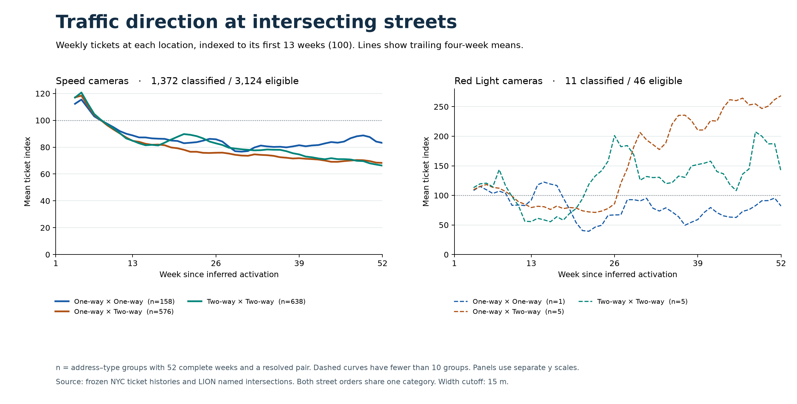
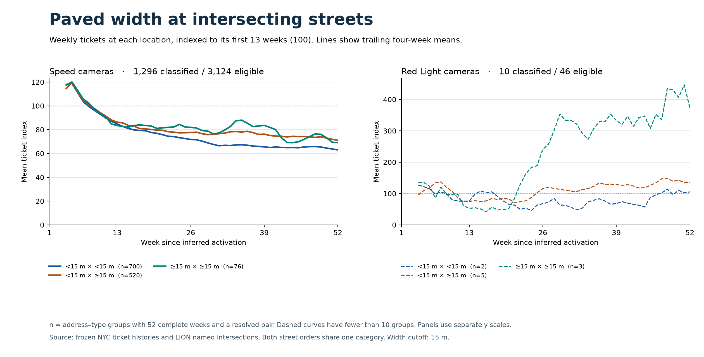
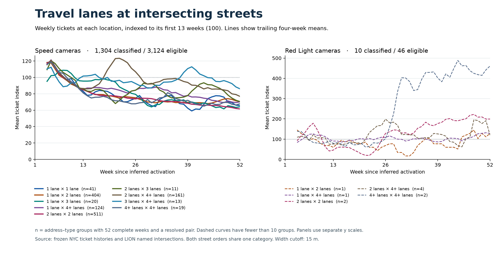

# Ticket trends by pairs of intersecting streets

This extension classifies the two streets named in each camera group's ticket address, then compares their first-year ticket trends. It preserves the original 4,610 address/type groups, inferred activation dates, frozen ticket snapshot and prior analysis outputs.

## Read the results

The three figures below are saved outputs and can be viewed directly on GitHub. The existing four-tab dashboard and notebooks retain their earlier first-street analysis; this extension is delivered separately.







## Matching and categories

The matcher retains the frozen first-street match, reverses the two named streets, and applies the same borough, normalized-name and 60 m spatial checks to the second street. Both streets must meet at exactly one common LION node and level, with distinct segment IDs and ordinary undivided street segments. Multiple nodes, overlapping aliases, unsupported roadbeds and unresolved attributes remain explicitly flagged.

- Direction pairs use One-way and Two-way categories.
- Width pairs use <15 m and >=15 m. Every valid minimum/maximum width on the adjoining segments must lie on the same side of the threshold; ambiguous widths remain unknown. The 15 m boundary is an analytical choice.
- Lane pairs use 1, 2, 3 and 4+ travel lanes. Counts on two-way streets include both directions.
- Street order does not affect a category. Direction, width and lanes are analyzed separately.

Across the full registry, 1,793 groups have both streets matched, representing 1,693 named street pairs and 1,686 node/level combinations. A pair describes the two named streets, rather than every arm of a complex intersection. It does not establish the enforced approach or historical road conditions.

## Trend definition and findings

The fixed cohort requires 52 complete Monday-Sunday weeks beginning on the first Monday on or after the unchanged inferred activation date. There are 3,124 eligible Speed groups and 46 eligible Red Light groups. Each location is indexed to its own weeks 1-13 mean of 100, then locations receive equal weight within each category. Zero baselines are excluded from indices. The figures show trailing four-week means; the first three smoothed values are missing.

The table compares the mean index in weeks 40-52 with the first-13-week baseline. Counts represent address/type groups, not physical devices or unique intersections.

| Camera type | Direction pair | Groups | Change |
|---|---|---:|---:|
| Speed | One-way x One-way | 158 | -15.3% |
| Speed | One-way x Two-way | 576 | -30.6% |
| Speed | Two-way x Two-way | 638 | -30.7% |
| Red Light | One-way x One-way | 1 | -23.1% |
| Red Light | One-way x Two-way | 5 | +157.1% |
| Red Light | Two-way x Two-way | 5 | +57.4% |

Only 11 of the 46 eligible red-light groups have a known direction pair, so these small subgroups cannot support broad conclusions. Unknown groups remain in the output tables but are omitted from these figures. Multiple address/type groups can share a node; an equal-node sensitivity statistic is also saved. These are changes in recorded ticket counts, not exposure-adjusted violation rates or camera effects.

## Reproduce locally

From the repository root, use the pinned environment and the existing frozen outputs described in the [parent README](../README.md):

```shell
uv sync --locked
uv run python experiments/camera-ticket-trends/build_intersection_pairs.py --lion-gdb /path/to/lion.gdb
uv run python experiments/camera-ticket-trends/plot_intersection_pairs.py
```

The build checks that the supplied LION file hashes equal those recorded in the original road-feature receipt. It reads the frozen camera summary, weekly panel, reconciliation audit, eligibility table, road-feature table and segment audit. It does not download historical tickets.

Generated tables remain local under `experiments/camera-ticket-trends/outputs/intersection_pairs/`, following the repository's data rules:

- `camera_pair_directory.csv`: all groups, matches, classifications and eligibility.
- `named_intersections.csv`: unique named street pairs and group counts.
- `pair_summary.csv`: category sizes, changes and equal-node sensitivity.
- `pair_weekly_trends.csv`: raw and indexed weekly summaries, dispersion and bootstrap bounds.
- `match_coverage.csv`: matched and unresolved counts.
- `methods.json`: definitions, reconciliation checks and input SHA-256 hashes.

## Validation

The frozen build reconciles each category's weekly counts, preserves the original cohort, checks unique weekly keys and stable pair classifications, and verifies baseline indices average to 100. Regression tests cover reversed street order, divided roads, overlapping aliases, ambiguous widths and distant nodes. Before upload on November 5, 2026, the full repository suite passed: 78 tests. The shared figures are byte-identical copies of the reviewed local exports; their hashes are recorded in `figure_checksums.json`.
