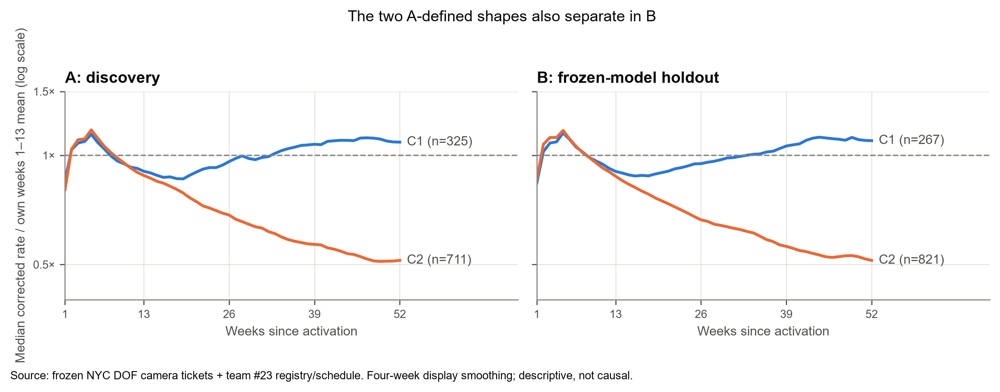
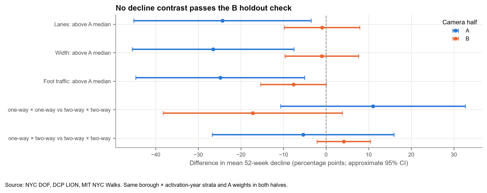

# Issue #58: corrected ticket trends

Review prepared 2026-11-22 for `yihan/pipeline-integration`. Implementation branch: `codex/issue-58-corrected-trends`.

**Calendar-corrected curves support two stable shapes in discovery half A, with similar shapes in held-out half B.** The roadway differences do not validate in B. Higher pedestrian volume is associated with the weaker-decline cluster in the primary specification, but the multiple-testing result is sensitive to the definition of an established camera.



## Results

The rebuilt registry has 2,990 speed-camera location groups. Seed 42 assigns 1,495 to each half before any outcome selection. Of these, 2,165 have an eligible 52-week decline estimate; 2,124 have all 52 corrected weeks needed for clustering (A: 1,036; B: 1,088).

| Check | A: discovery | B: frozen-model holdout |
|---|---:|---:|
| Selected number of clusters | 2 | Same A model, no refitting |
| Silhouette | 0.263 | 0.287 |
| Mean resampling stability, adjusted Rand index | 0.969 | Not used to select the model |
| C1: weaker decline/rebound | 325 | 267 |
| C2: sustained decline | 711 | 821 |
| C1 median 52-week decline | −8.0% | −9.0% |
| C2 median 52-week decline | 45.6% | 46.1% |

Positive decline means fewer tickets relative to established cameras; a negative value means an increase. These are descriptive violation trends, not estimates of prevented crashes.

Numeric feature cutpoints were learned on A only: **2 travel lanes**, **54.5 ft road width**, and **523 modeled pedestrians across the three weekday peak-hour periods**. Direction pairs use two-way × two-way as the reference. Missing/ambiguous features remain missing.

Within common **borough × activation-year** strata, applying the same A-derived weights to both halves:

- Higher pedestrian volume is associated with **8.2 percentage points more C1 membership in B** (approximate 95% CI 2.4–13.9; Holm-adjusted p = 0.026). The A difference is 8.8 points.
- Lane count and width show associations in A, but neither passes the B check.
- One-way × one-way does not validate: its cluster-membership association changes sign between halves. The earlier unadjusted −15% versus −31% comparison should not be treated as a supported finding.
- None of the five continuous-decline contrasts passes its separate B multiplicity check. The pedestrian evidence concerns cluster membership; it does not establish a precise difference in mean decline.



## Sensitivity to the reference-camera age

The primary age was set to 52 weeks before inspecting the results. The two alternatives are robustness checks, not a search for a more favorable result. C1 is consistently ordered as the cluster with the least mean decline in A.

| Minimum age | Selected k | A silhouette | A stability ARI | B silhouette | Pedestrian C1 difference in B | B adjusted p |
|---|---:|---:|---:|---:|---:|---:|
| 26 weeks | 2 | 0.249 | 0.968 | 0.270 | +7.8 pp | 0.073 |
| **52 weeks** | **2** | **0.263** | **0.969** | **0.287** | **+8.2 pp** | **0.026** |
| 104 weeks | 2 | 0.288 | 0.978 | 0.302 | +8.3 pp | 0.019 |

The shape result is consistent across these definitions. The pedestrian association is a useful follow-up hypothesis, with less decisive statistical support under the 26-week definition.

## What was reused

| Existing work | Use in this revision |
|---|---|
| Eric's #23 `camera_activation_dates.csv` | Current schedule-aware activation date, alternatives, confidence and left-censoring flags |
| `preprocessing/cameras.py` | Existing schedule-hour and month parsers; daily aggregation adds correct boundary-week hours |
| `preprocessing/camera_ticket_trends.py` | Existing deduplication, camera identities, weekly counts, coverage rules and reconciliation; rebuilt from the frozen raw cache |
| `preprocessing/camera_locations.py` | The canonical LION location matcher; the legacy Yihan matcher is not called by this revision |
| `preprocessing/roadway.py` and `preprocessing/base.py` | Road cleaning, spatial joins, lanes and width; existing street-name parser for the two named directions |
| `preprocessing/pedestrians.py` and `data/download.py` | Team NYC Walks downloader and maximum modeled volume within 100 ft |
| `preprocessing/camera_shared_trends.py`, `model/camera_shape.py`, `validation/camera_shared_trends.py` | Existing four-week/log/within-camera shape transformation, KMeans and stability-based selection |
| `viz/style.py` | Shared figure style |

Latest `main` (`fe92543327765a5e3720b4a3c7733bcb43b88a3c`) was merged locally into the existing pipeline branch in `63f2aae`. The two merge conflicts only combined independent reader functions and imports. The old test that hard-coded the superseded 4,610-row registry was updated for #23's schema; the analysis still checks the registry receipt before using weekly inputs.

## Definitions and safeguards

1. Sum permitted hours **daily**, then group by Monday–Sunday week. Divide weekly tickets by these hours. Summer and zero-hour weeks are missing, not zero violation rates. Unknown schedule days remain missing. #23's ticket-volume-based holiday exclusion is not used to delete low-volume weeks from this analysis.
2. For each real calendar week, divide the hourly rate by the mean of eligible established **A cameras only**, with high/medium activation confidence. At least 20 contributing cameras are required. A camera is excluded from its own reference mean. B cannot change A's correction, choice of k, or feature bins.
3. Align the corrected observations to the first Monday on or after activation. The 52-week decline is `100 × (1 − mean(weeks 40–52) / mean(weeks 1–13))`, with at least 8 usable weeks in each endpoint window and complete source coverage through week 52. A zero starting mean has no percentage estimate.
4. Exclude left-censored and low-confidence activations from first-year outcomes, while retaining them with an explicit reason in the camera directory. Already-running high/medium-confidence cameras may supply reference weeks once their observed age meets the threshold.
5. Cluster only complete 52-week corrected curves. Select k on A using the existing silhouette, resampling stability and minimum-size criteria. Assign B with the frozen A fit. If no candidate passes, the pipeline automatically switches to the continuous 52-week decline outcome; the current run did find a passing model.
6. Freeze medians and categorical reference levels on A. Compare the same groups in B within common borough × year strata, requiring at least two cameras per cell and ten per contrasted group overall. Both halves use the same A weights. Intervals are approximate normal intervals; B p-values use Holm correction over the five planned comparisons. Cluster membership is the primary feature outcome when clusters exist; continuous decline is secondary in that case.

Exclusions from the 2,990 speed groups are mutually exclusive: **284 left-censored**, **237 low activation confidence**, **186 incomplete first year**, and **118 insufficient corrected endpoint weeks**. Another 41 outcome-eligible cameras lack a complete corrected curve and do not enter clustering.

High-confidence spatial features cover 2,375 direction pairs, 2,661 lane/width records, 2,656 pedestrian records and 2,658 borough labels. Unverified or ambiguous locations remain in the outcome directory but are excluded from spatial feature claims.

## Reproduce

From the repository root, with `uv` available:

```powershell
uv sync
uv run pytest -q

# Raw source cache already available locally; no fresh ticket download is needed.
uv run python -m preprocessing.camera_ticket_trends --cache ../Group-7-Capstone-ticket-trends/data/raw/camera_ticket_trends_20261014 --work-dir ../Group-7-Capstone-ticket-trends/data/processed/camera_ticket_trends --output-dir experiments/camera-ticket-trends/outputs/revised_inputs

# Requires data/lion/lion.gdb and the team NYC Walks shapefile.
# On a new machine: use the shared downloader for NYC Walks.
uv run python -c "from data.download import download_nycwalks; download_nycwalks()"
uv run python experiments/camera-ticket-trends/revise_clustering.py
uv run python experiments/camera-ticket-trends/plot_revised_clustering.py
```

For another established-camera age, pass `--established-weeks 26` or `104` and a different `--output-dir`. `--reuse-features` reuses that output directory's `site_features.csv`, after checking camera IDs; use a fresh run whenever spatial inputs change. Local completed alternatives are in `outputs/issue58-age26/` and `outputs/issue58-age104/`.

The local uv executable used for this review is `../Group-7-Capstone-ticket-trends/.tools/uv/uv.exe`; prepend `&` when invoking that quoted path in PowerShell. The new worktree has its own `.venv` and does not replace an existing environment.

## Inspectable outputs and validation

Full local outputs are in [`../outputs/issue58/`](../outputs/issue58/):

- `result.json`: parameters, A-defined bins, checks, input/code/spatial hashes and summary counts.
- `camera_outcomes.csv`: all 2,990 speed groups, split, exclusions, cluster, decline and site features.
- `corrected_calendar_weeks.parquet` and `calendar_reference_coverage.csv`: hours, reference counts/means and calendar correction.
- `cluster_diagnostics_A.csv`, `cluster_outcomes.csv`, `cluster_feature_profiles.csv`: candidate models and frozen A/B profiles.
- `cluster_feature_validation.csv`: primary held-out membership comparisons.
- `feature_validation.csv`, `feature_validation_strata.csv`: secondary decline comparisons and their borough/year cells.
- `eligibility_by_year.csv`: attrition by year and half.

Validation: **139 pytest tests passed**, including schedule boundaries, common-shock cancellation, leave-one-out references, B-to-A leakage protection, zero denominators, censoring, coverage, reproducible splits, frozen cluster labels, stratified comparisons and shared street matching. New Python files pass Ruff; `git diff --check` passes. All eight real-data reconciliation/acceptance checks pass.

The frozen input contains **45,880,884 source records**, **1,886,216 duplicate rows**, and **43,994,668 distinct ticket identifiers**. The rebuilt counts reconcile to **42,107,352 post-activation tickets**, **108,755 pre-activation tickets**, and **1,778,561 unmatched tickets** across speed and red-light records. Matching/counting covers the frozen extract ending 2026-08-30, not a newly refreshed extract.

## Limits that affect interpretation

- The schedule gives permitted hours, not actual camera uptime or a complete school-holiday calendar. Common-week normalization only removes approximately shared proportional shocks; effects can differ by borough, traffic mix and time of day.
- The source unit is a camera location-text group, not an independently verified device. The unresolved location/duplicate-coordinate concerns in #45 and nearby corridor dependence mean this is a random camera-group holdout, not a geographic or causal validation.
- Complete-curve selection excludes some summer-spanning early cohorts. The supplied LION snapshot's release was not independently established; its bytes are pinned. NYC Walks is a fixed modeled 2018–19 weekday snapshot, not pedestrian exposure at each activation date. Cite [City Form Lab NYC Walks](https://cityform.mit.edu/projects/nycwalks) and its Nature Cities paper (doi:10.1038/s44284-025-00383-y).
- The primary run uses #23's schedule-aware activation definition. Its alternative activation-date columns are retained in the output; a full alternative-date robustness study is outside this ticket-clustering revision.

This change spans preprocessing (correction and spatial inputs), validation (splits, selection and holdout comparisons), and experiment orchestration. It adds no dependency and performs no GitHub write.
